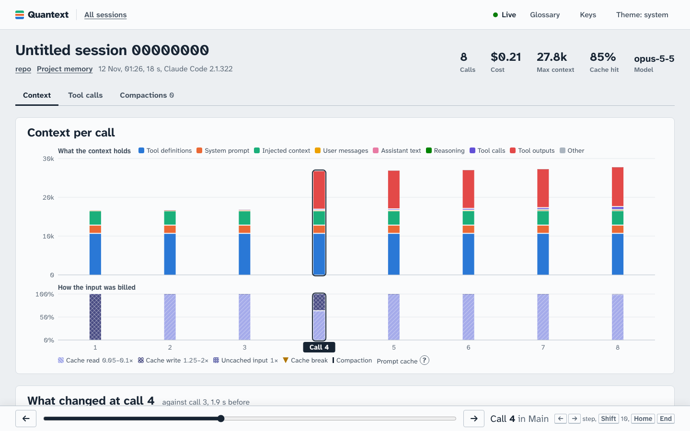

# Quantext

Quantext reads the session logs of coding agents (Claude Code first), rebuilds exactly what the model received on
every call, and shows where the context tokens go: in a live web viewer, in a status line inside the harness, and to
agents through SQL and a CLI. Nothing leaves the machine.

**Status: early release (0.1).** Claude Code only, macOS and Linux. Expect rough edges; see
[known issues](docs/known-issues.md).



## What you get

- **A status line in Claude Code:** `qx $3.42 · ctx 182k · cache 96%`, from the harness's own numbers.
- **Nudges** (toasts, never added to the model's context): the prompt cache expired after idle time and the next
  call re-wrote it; the context passed 200k.
- **`/clear-tool-outputs [keep N]`:** compacts by replacing old tool outputs with short stubs instead of a summary.
- **`/quantext view`:** opens a live viewer on `http://127.0.0.1:4747` with every session on the machine:
  - the context of each call, exactly as the model received it (system prompt, tool schemas, messages), with the
    tokens and cost of each block, and what was read from the cache or written to it;
  - what changed since the previous call, and why the cache broke;
  - each call's answer, tool calls and their lifetime cost, compactions, subagents, project memory;
  - short explainers of the concepts (press `g`).

## Install

Install from a clone (installing straight from the marketplace is not supported yet):

```sh
git clone https://github.com/maxsoldev/quantext.git && cd quantext
npm i -g corepack@latest && corepack enable      # Node ≥ 22.18; skip if Corepack is already enabled
pnpm install && pnpm build:plugin                  # builds dist/plugin: the mod, the engine and the viewer
claude plugin marketplace add "$PWD"
claude plugin install quantext@quantext
```

Then start a new Claude Code session (or run `/reload-plugins`) and type `/quantext view`. The viewer needs Node
≥ 22.18 or Bun on your `PATH`; the status line and the commands work without them. The first start reads all your
transcripts once (about 30 s per GB). The engine stops by itself 10 minutes after the last viewer tab closes.

To update: `git pull && pnpm install && pnpm build:plugin`, then `/reload-plugins`. To remove:
`claude plugin uninstall quantext@quantext` and `rm -rf ~/.quantext`.

## Privacy and security

Quantext is **fully local**. It has **no telemetry**, no analytics, no update checks and no crash reporting, and it
makes **no outbound connections**.

- **Reads**, read-only: Claude Code's transcripts and memory files under `~/.claude` (or `CLAUDE_CONFIG_DIR`).
- **Writes** only `~/.quantext/` (folder 0700, files 0600).
- **Network**: one HTTP server on `127.0.0.1`, for the viewer. The mod talks only to it.

CI enforces this on the files we ship: a static no-egress guard reads the built plugin, and the engine's smoke
test runs with a network tripwire.

**Small supply-chain surface.**

- The engine and the mod have **no third-party runtime dependencies**: only Node and Bun built-ins.
- The viewer bundles **five well-known packages**: React, react-dom and scheduler (MIT), and the Atkinson
  Hyperlegible fonts (OFL-1.1). The plugin's `THIRD_PARTY_NOTICES.md` lists them with their licence texts.
- Build tools (TypeScript, Vite, Rolldown, Vitest, Biome) are not shipped. A compromised build tool could still
  change the bundle, so every package is pinned in the lockfile, comes from the npm registry with an integrity
  hash and a verified registry signature, waits a day after release before we take it, and may not run an
  install script. CI also checks for known vulnerabilities and licences, and the no-egress guard checks what the
  build produced.

Details, and how to report a vulnerability: [SECURITY.md](SECURITY.md).

## Requirements and setup (contributors)

- Node ≥ 22.18. Bun 1.3 or later to run the tests under Bun too.
- pnpm through Corepack. Node 25 and later ship without Corepack, so install it first:

  ```sh
  npm i -g corepack@latest && corepack enable
  pnpm install
  pnpm check        # lint, types, tests, layer check, scans
  pnpm check:bun    # the runtime-specific checks under Bun
  pnpm build        # the viewer (Vite) and the engine bundle, with the viewer in dist/web
  pnpm e2e          # build, then the viewer's Playwright tests (once: pnpm exec playwright install chromium)
  ```

  Viewer development: run an engine (`pnpm qx serve …`), then `QX_ENGINE=http://127.0.0.1:<port> pnpm -F
  @quantext/web dev`; Vite proxies `/api` and `/health` to it.

  An older global pnpm may fail to switch itself to the pinned version. Then run `corepack pnpm …` instead.

## Docs

- [Architecture](docs/ARCHITECTURE.md): layers, domain model, release plan, quality bar.
- [Glossary](docs/GLOSSARY.md) and [decision records](docs/adr/).
- [Known issues](docs/known-issues.md): what we know is wrong or missing, and chose to defer.
- [Working rules](AGENTS.md) for contributors and coding agents.
- [Security](SECURITY.md): what Quantext reads, writes and sends, and how we check it.

Licence: [Apache-2.0](LICENSE).
